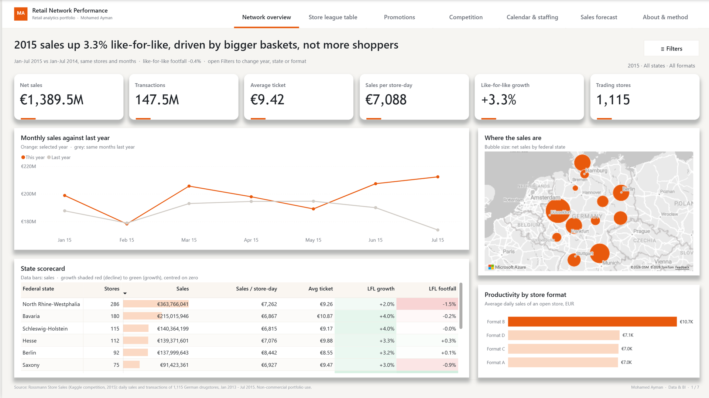
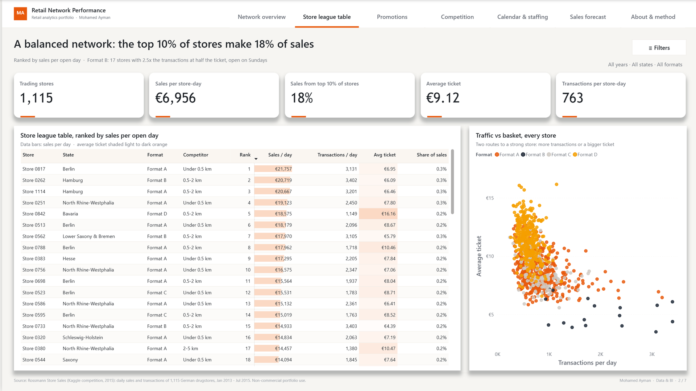
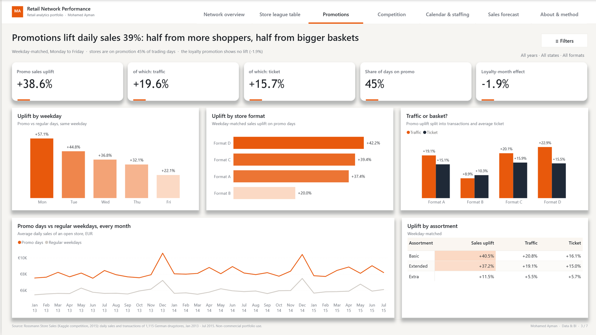
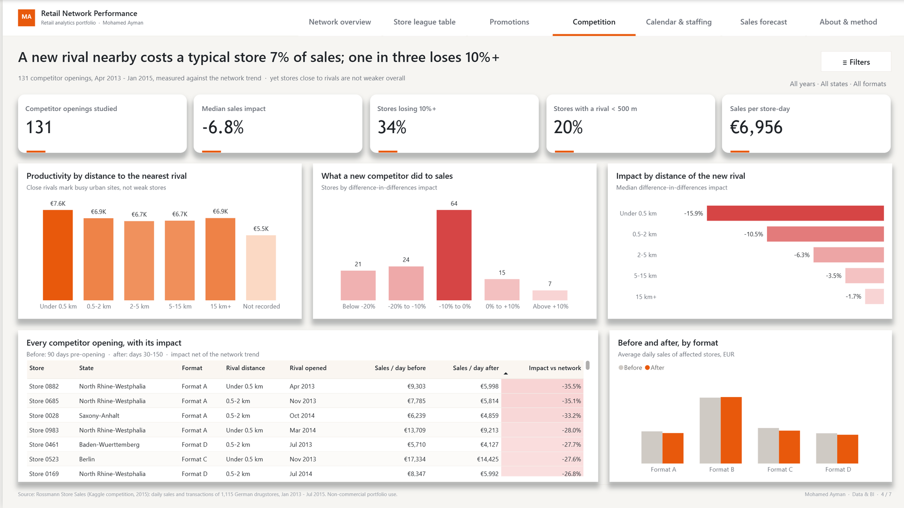
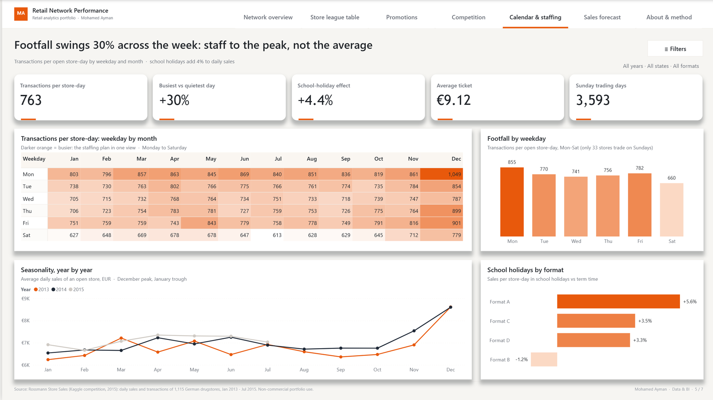
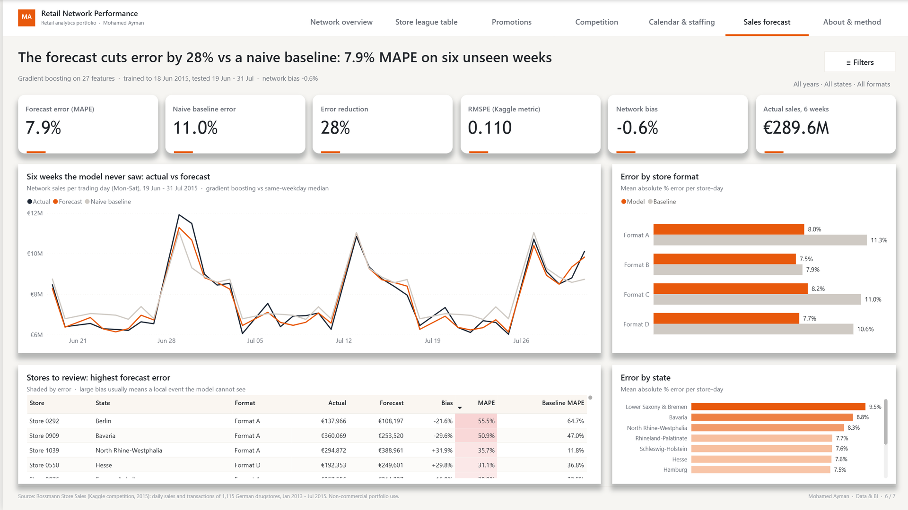
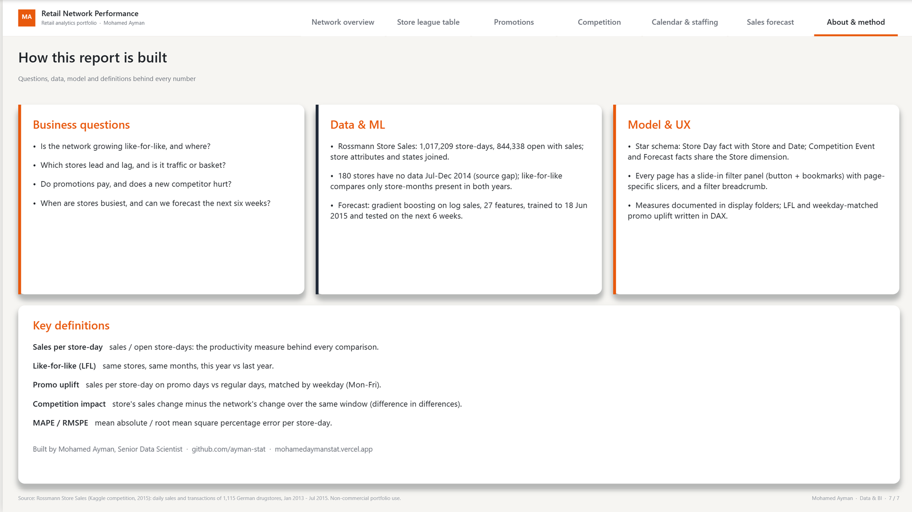
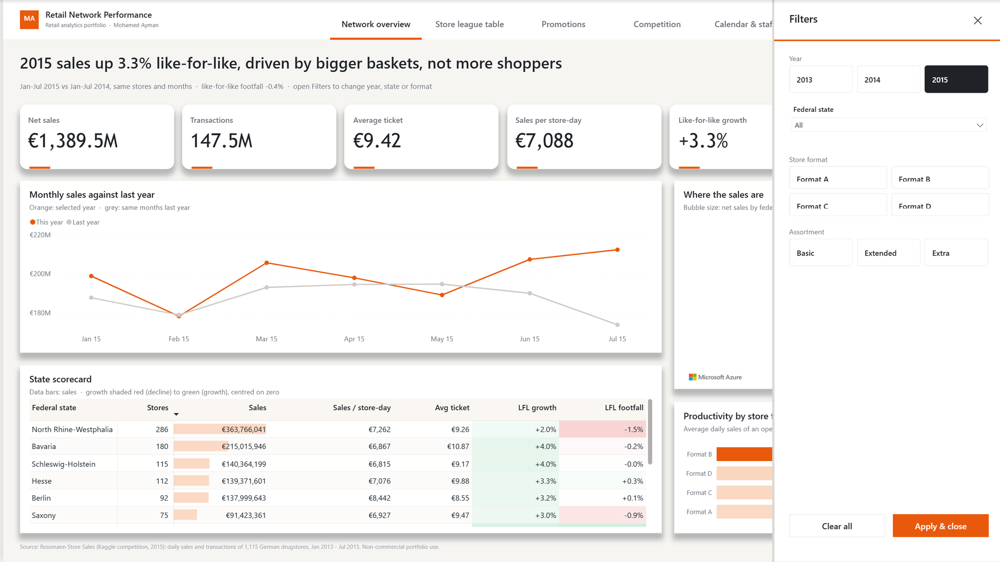

# Retail Network Performance

Like-for-like growth, store league tables, promotion and competition effects, staffing patterns and a six-week sales forecast for a 1,115-store drugstore chain.

**Domain:** Retail / store operations  ·  **Built with:** Power BI Desktop (PBIP, PBIR, TMDL), DAX, Python  ·  **Author:** [Mohamed Ayman](https://mohamedaymanstat.vercel.app)



## What the data says

- 2015 sales are up 3.3% like-for-like, driven by bigger baskets; like-for-like footfall is flat (-0.4%).
- Promotions lift daily sales 39% (weekday-matched): about half from more shoppers, half from bigger baskets. The loyalty promotion shows no lift.
- A new competitor nearby costs a typical store 7% of sales (difference in differences); one in three loses 10% or more.
- Footfall swings 30% across the week: staff to the peak, not the average.
- The forecast cuts error by 28% vs a naive baseline: 7.9% MAPE on six unseen weeks.

## Pages

| Page | Preview |
|---|---|
| 1. Network overview |  |
| 2. Store league table |  |
| 3. Promotions |  |
| 4. Competition |  |
| 5. Calendar & staffing |  |
| 6. Sales forecast |  |
| 7. About & method |  |
| Filter panel (open) |  |

## Model and DAX

- A slide-in filter panel per page (button + display-only bookmarks) with page-specific slicers, a Clear all button and a filter breadcrumb.
- Like-for-like sales and footfall in DAX (same stores, same months).
- Weekday-matched promotion uplift, decomposed into traffic and ticket.

## Machine learning

- Forecast: gradient boosting on log sales with 27 features (calendar, promotions, holidays and distance to them, store encodings from the training window only).
- Backtest: trained to 18 Jun 2015, tested on 19 Jun - 31 Jul 2015 (the Kaggle horizon); RMSPE 0.110 vs 0.148 for the baseline.
- Competition: difference-in-differences event study on 131 competitor openings.

## Data science

Three notebooks reproduce the report's forecast and causal numbers exactly, then test them harder ([ds/README](ds/README.md), [model card](ds/model_card.md)):

- [01 · EDA and time series](ds/notebooks/01_eda_time_series.ipynb): data audit, seasonality (weekday, payday, Christmas), STL and autocorrelation.
- [02 · Forecast model](ds/notebooks/02_forecast_model.ipynb): a four-fold rolling-origin backtest. The published model beats every baseline in every fold (MAPE 7.7-8.2% vs 10.3-12.2%) and a tuned LightGBM challenger does not beat it. Also covers error analysis, P10-P90 intervals, SHAP and staff-hours.
- [03 · Causal effects](ds/notebooks/03_causal_effects.ipynb):
  - Promotions: +39% (95% CI +37% to +41%) with fixed effects and week-clustered errors.
  - Competitor openings: −7.9% (95% CI −9.8% to −6.0%) in an event study with flat pre-trends, placebo tests and a distance dose-response.

## Design

- Identity: **Retail**: warm white, orange and charcoal, underline-tab navigation, soft card shadows, and a slide-in filter panel on every page.
- Every page states its finding as the title, names its source in the footer and uses readable field names.
- Value-driven colour (gradients) on bars, conditional formatting in tables, numbers right-aligned under right-aligned headers.
- Each report in this portfolio has its own visual identity; see the other repos linked below.

## Data

- [Rossmann Store Sales (Kaggle competition, 2015)](https://www.kaggle.com/competitions/rossmann-store-sales): 1,017,209 daily store records, Jan 2013 - Jul 2015; store-to-state map from entron/entity-embedding-rossmann. Licence: Kaggle competition rules.

The source licence does not allow redistribution, so `data/` is not committed. To rebuild it, download the source files into `.raw/` as described at the top of `etl/build_data.py`, then run the ETL.

## How to run

1. Open `RetailNetwork.pbip` in Power BI Desktop (October 2026 or later; PBIR and DAX user-defined functions).
2. Build the data (step below), set the `DataSource` parameter to `Local` and `LocalDataFolder` to this repo's `data\` folder, then refresh.
3. To rebuild everything from source:

```bash
pip install pandas numpy scikit-learn scipy openpyxl xlrd pyarrow
python etl/build_data.py      # source data -> data/*.csv (and models, where relevant)
python build/model.py         # writes the TMDL semantic model
python build/report.py        # writes the PBIR report
```

The report and model are generated from code (`build/`, using a shared design toolkit), so every visual, measure and page is reviewable in a diff.

## Limitations

- 180 stores have no data for Jul - Dec 2014 (a gap in the source); like-for-like compares only store-months present in both years.
- Competition data records only the nearest competitor.

## More in this portfolio

- [Olist Marketplace Performance](https://github.com/ayman-stat/powerbi-olist-marketplace): E-commerce / marketplace
- [Retail Bank Campaign Strategy](https://github.com/ayman-stat/powerbi-bank-campaign-strategy): Banking / direct marketing
- [CVM Command Centre: retention, churn and offer experiments](https://github.com/ayman-stat/powerbi-cvm-experiments): CVM / retention / experimentation
- [Card Portfolio & Risk](https://github.com/ayman-stat/powerbi-card-portfolio-risk): Payments / cards / credit risk
- [Telecom Churn & Subscriber Value](https://github.com/ayman-stat/powerbi-telecom-churn-value): Telecom / CVM

---
Mohamed Ayman, Senior Data Scientist  ·  [Portfolio](https://mohamedaymanstat.vercel.app)  ·  [GitHub](https://github.com/ayman-stat)  ·  [LinkedIn](https://www.linkedin.com/in/mohamed-ghareb/)
