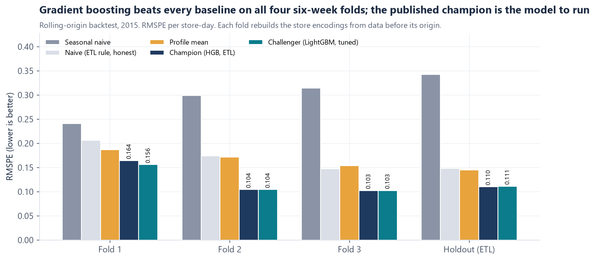
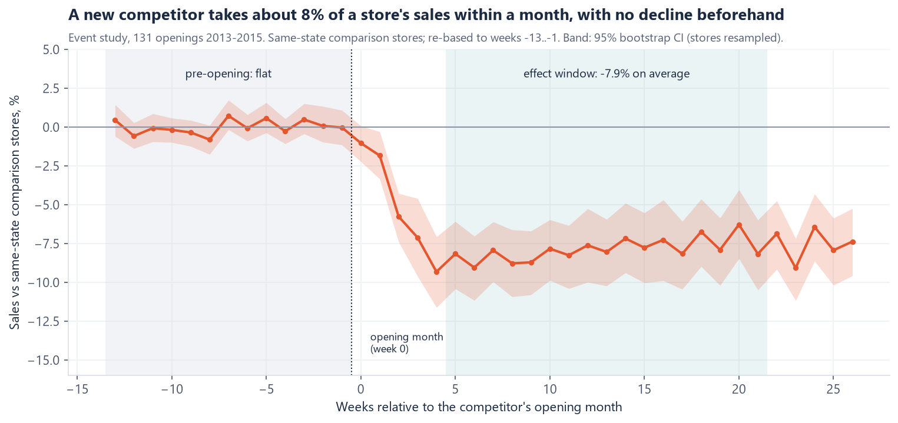
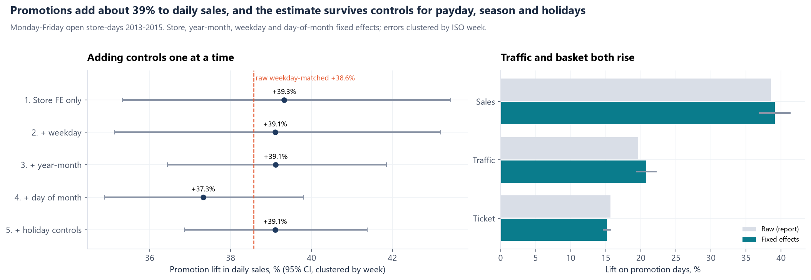
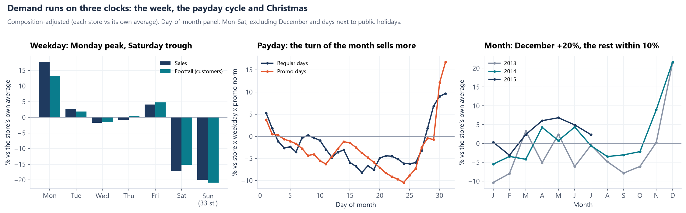

# Data science: six-week store forecast and causal effects of promotions and competitors

This folder adds three reviewable notebooks to the Power BI report. The forecast question is how much each of 1,115
stores will sell on each of the next 42 days, for staff rosters and stock. The causal question is what promotions and
new competitors really do to sales. The notebooks reproduce every forecasting and causal number the report publishes
before extending them.

Data: Rossmann Store Sales (Kaggle competition, 2015), 1,017,209 store-days, Jan 2013 - Jul 2015. The licence does not
allow redistribution, so the notebooks show profiles and aggregates only, and you need the source files in `.raw/` to
rerun them (see `etl/build_data.py`).

## Lifecycle

| Stage (CRISP-DM) | Notebook | Key output |
|---|---|---|
| Business and data understanding | [01_eda_time_series](notebooks/01_eda_time_series.ipynb) | Audit (closed days, 54 zero-sales days, the 180-store gap, structural missing fields); three demand clocks (weekday, payday, Christmas); STL and ACF; promotions found to be network-wide and week-level |
| Data preparation | [`features.py`](features.py) + [tests](../tests/test_features.py) | The ETL's 27 features rebuilt per forecast origin, with no look-ahead (tested by rewriting the future) |
| Modelling and evaluation | [02_forecast_model](notebooks/02_forecast_model.ipynb) | Exact parity with the published backtest; four-fold rolling-origin backtest; five candidates; pre-registered champion/challenger rule; error analysis; P10-P90 intervals; SHAP; staff-hours |
| Causal analysis and decision | [03_causal_effects](notebooks/03_causal_effects.ipynb) | Promotion lift with fixed effects and week-clustered errors; loyalty promotion; competitor event study with placebos and dose-response |

## Results

**Forecast (RMSPE per store-day; lower is better).** Folds 1-3 are rolling six-week windows in 2015; the holdout is the
ETL's published backtest (19 Jun - 31 Jul 2015).

| Model | Fold 1 | Fold 2 | Fold 3 | Holdout | MAPE, holdout |
|---|---|---|---|---|---|
| Seasonal naive (last week) | 0.241 | 0.299 | 0.314 | 0.343 | 23.7% |
| Naive, ETL rule (8-week median by store x weekday x promo) | 0.207 | 0.174 | 0.147 | 0.148 | 11.0% |
| Profile mean (store x weekday x promo) | 0.187 | 0.172 | 0.154 | 0.145 | 10.7% |
| **Champion: HistGradientBoosting (ETL, published)** | **0.164** | **0.104** | **0.103** | **0.110** | **7.9%** |
| Challenger: LightGBM, Optuna-tuned | 0.156 | 0.104 | 0.103 | 0.111 | 8.0% |

* **Parity.** RMSPE 0.1102, MAPE 7.93% and bias −0.6% reproduce exactly; all 41,396 store-day forecasts match the published
  `fact_forecast.csv`.
* **Champion vs challenger.** The challenger is not better on every fold and is worse on the holdout (ΔRMSPE −0.0012, 95%
  store-block bootstrap CI −0.0019 to −0.0003). The rule fixed in advance keeps the published model.
* **Where the error is.** Days next to public holidays (MAPE 9.0% vs 7.8%), and 50 stores that carry 23% of the squared
  error. Refurbishment-style closures are 12× over-represented among those stores. The error does not grow across the six weeks.
* **Uncertainty.** LightGBM quantile models give P10-P90 bands that cover 74.6% of holdout days (target 80%); they need
  conformal widening before use.
* **Value.** At an illustrative EUR 125 of sales per staff-hour, the model removes about 63,000 mis-planned staff-hours
  per six weeks across the network compared with the naive rule.

**Causal effects.**

| Question | Published (report) | This analysis |
|---|---|---|
| Promotion lift, daily sales | +38.6% (weekday-matched) | **+39.1%** (95% CI +36.9% to +41.4%): store, year-month, weekday and day-of-month fixed effects, holiday controls, errors clustered by week |
| ... traffic / ticket | +19.6% / +15.7% | +20.8% / +15.2% |
| Loyalty promotion month | −1.9% | −0.3% (CI −0.5% to 0.0%) with store and date fixed effects: the −1.9% is seasonality |
| Competitor opening, median store impact | −6.8% (131 events) | −6.8% reproduced; event study **mean −7.9% (CI −9.8% to −6.0%)**, median −6.2%, flat pre-trends, placebo 95% range −0.7% to +0.7% (p = 0.003) |
| ... within 500 m / beyond 5 km | - | −16% / under −2% |

## Key figures






## Reproduce

From the repo root, with the source files in `.raw/rossmann/` and the project's Python environment:

```bash
pip install -r requirements-ci.txt lightgbm optuna shap statsmodels jupytext nbconvert ipykernel
ruff check ds tests && pytest -q                      # synthetic-data tests, no raw files needed
python -m jupytext --set-kernel python3 --to ipynb --execute ds/notebooks/01_eda_time_series.py   # ~20 s
python -m jupytext --set-kernel python3 --to ipynb --execute ds/notebooks/02_forecast_model.py    # ~6 min (4 threads)
python -m jupytext --set-kernel python3 --to ipynb --execute ds/notebooks/03_causal_effects.py    # ~1.5 min
```

The `.py` files are the reviewable source (jupytext percent format); the `.ipynb` files are the executed versions.
Headline numbers are written to [`reports/metrics.json`](reports/metrics.json). The model card is in [`model_card.md`](model_card.md).
`dskit/` is the shared helper library used across this portfolio (vendored; tested in `tests/test_dskit.py`).
